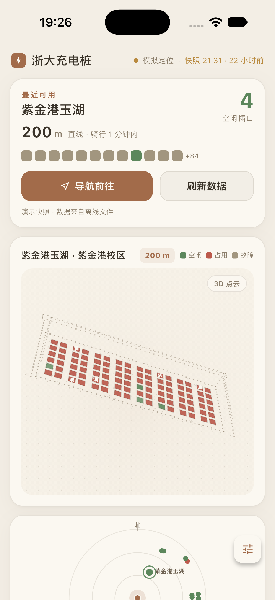
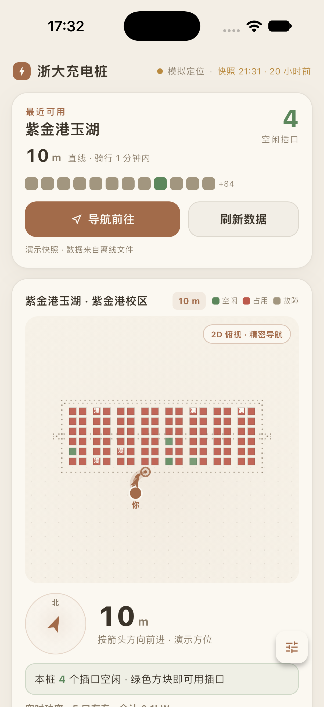
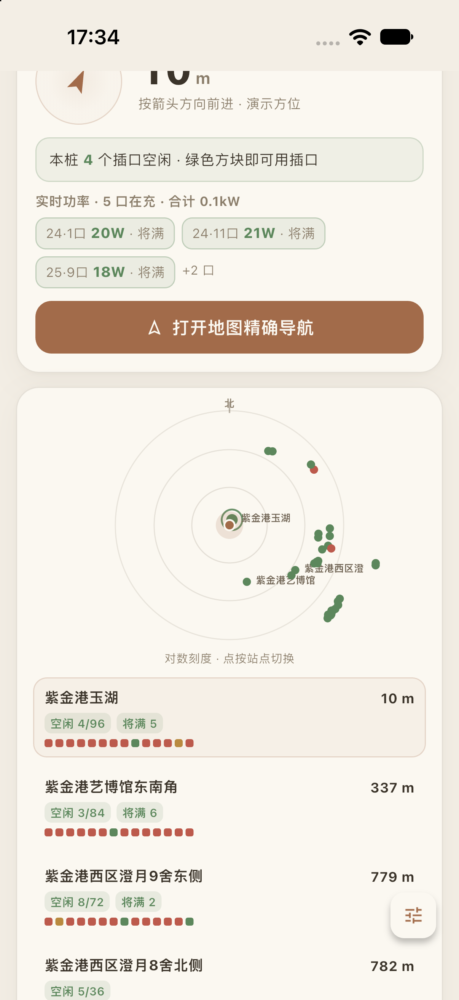
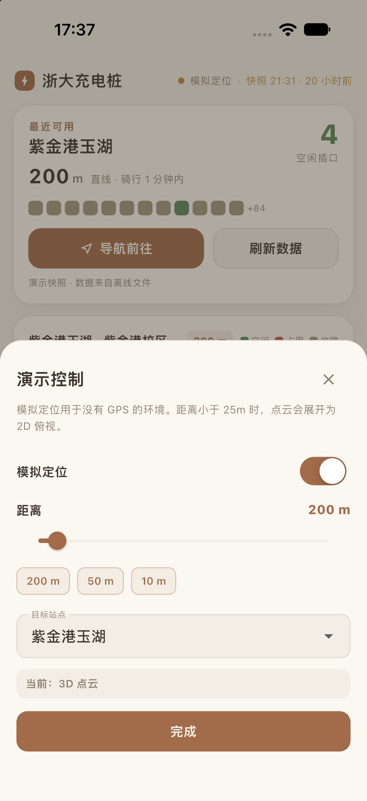
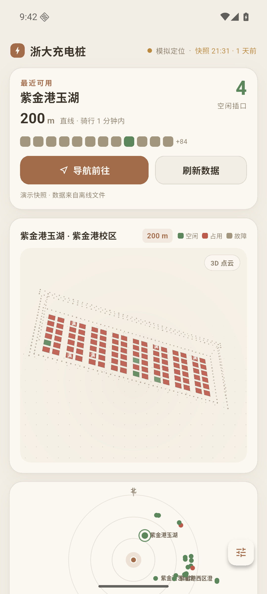
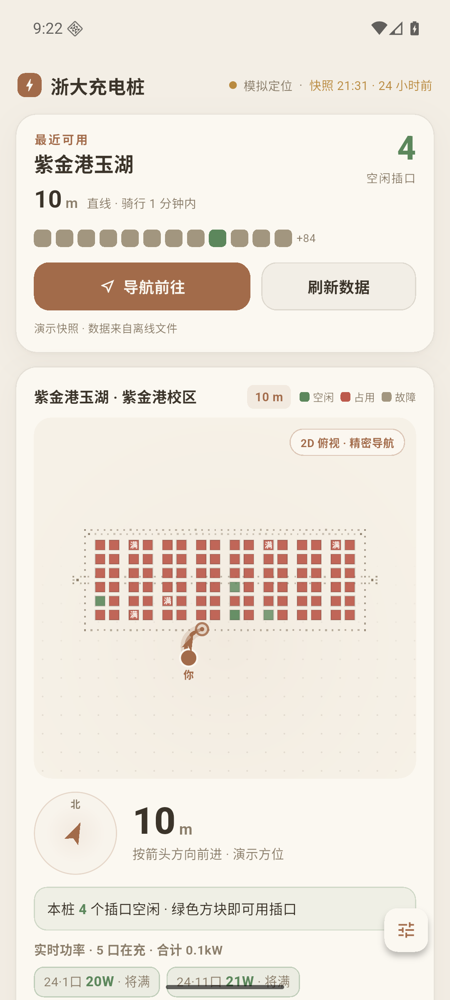
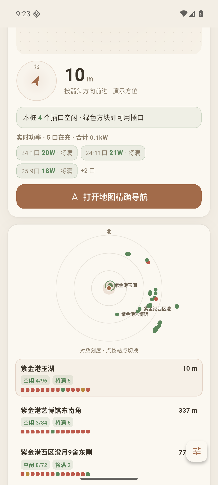
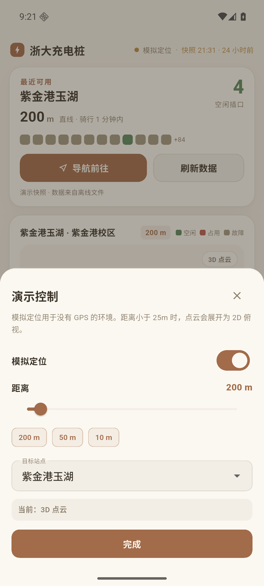

# 浙大充电桩

浙江大学充电桩找桩与插口状态展示应用。当前仓库是可运行的 Flutter demo，数据使用离线快照，重点验证 3D 点云、2D 精确俯视和移动端交互。

## 项目状态

| 项 | 状态 |
| --- | --- |
| iOS 模拟器 | 已验证（iPhone 18 Pro / iOS 27） |
| Android 模拟器 | 已验证（Pixel 7 / Android 16 / API 36） |
| Android 构建 | debug APK 约 146 MB，release APK 约 54 MB |
| 数据 | 离线快照 + FastAPI 实时网关 |
| 实时网关 | 已实现：全量/单站刷新、功率遥测、快照 JSON、匿名推送 |
| 客户端联调 | Android debug 包已拉到真实 `/v1/snapshot` |
| 本地收藏 / 空位提醒 | 本地收藏已实现；提醒订阅与空跑已实现，真实 JPush 联调待账号 |
| 账号 / 跨设备同步 | 永久取消，不做登录、用户表、跨设备收藏 |
| HarmonyOS | 最后处理，尚未开始 |
| 内嵌地图 | 暂不做，v1 使用外部高德 URI |

## 截图

### iOS 模拟器

| 3D 点云 | 2D 俯视 |
| --- | --- |
|  |  |

| 精密导航与功率 | 演示控制 |
| --- | --- |
|  |  |

### Android 模拟器

| 3D 点云 | 2D 俯视 |
| --- | --- |
|  |  |

| 精密导航与功率 | 演示控制 |
| --- | --- |
|  |  |

## 功能

- 最近可用站点自动锁定、直线距离与骑行时间估算
- 站点/设备/插口三级数据，精确到每个插口
- 3D 点云桩体、轻微振荡、插口状态与浮充「满」标记
- 25m / 40m 回差，3D 点云展开为 2D 俯视
- 2D 导航线路、指南针、距离、空闲插口计数
- 实时功率快照、将满提示
- 对数刻度雷达、附近列表、点按切换站点
- 演示控制面板：模拟定位、距离滑块、站点选择
- 外部高德导航跳转
- 本地收藏、收藏夹、当前站空位提醒
- 单站刷新，更新后显示该站 `observed_at`
- 通知点击回到对应站点
- 离线快照、数据年龄提示

## 技术栈

- 客户端：Flutter 3.47.8 / Dart 3.13.7
- 状态管理：Riverpod
- 3D/2D 点云：CustomPainter + vector_math
- 导航：`url_launcher` + 高德 URI
- 数据：内置 JSON 快照 / FastAPI 实时网关
- 后端：Python 3.14 / FastAPI / httpx / JSON 快照 / SQLite（仅推送订阅）
- 推送：极光 JPush（Android/iOS；HarmonyOS 后续）
- Android：Android SDK API 36 / OpenJDK 17
- iOS：Xcode 27 / iOS 27 Simulator

## 目录结构

```text
zju-charger/
├── app/                         Flutter 客户端
│   ├── lib/
│   │   ├── core/                主题、地理计算、格式化、导航
│   │   ├── data/                快照加载
│   │   ├── features/
│   │   │   ├── debug/           演示控制面板
│   │   │   └── home/            首页、HERO、点云、雷达、列表、精密面板
│   │   ├── models/              快照/站点/设备/插口/功率模型
│   │   └── state/               Riverpod 演示状态
│   ├── assets/data/             离线快照
│   └── test/                    单元测试与 Widget 测试
├── backend/                     FastAPI 数据网关
│   ├── app/                     抓取、解析、存储、API
│   ├── data/                    站点清单、种子快照、snapshot.json、push.db
│   ├── app/push.py              空位事件检测与 JPush
│   └── tests/                   后端测试
├── infra/                       Docker Compose 与 Caddy 示例
├── .github/                     CI、PR 模板
├── docs/                        设计、Demo、Android、后端、CI、决策、后续清单
├── screenshots/                 iOS 与 Android 截图
└── README.md
```

## 每次提交自动打包

每次 push / PR 都会运行 CI：

1. Flutter format / analyze / test
2. 后端 pytest
3. Android debug + release APK

构建成功后在该 Actions run 页面底部的 **Artifacts** 下载：

```text
zju-charger-android-<commit-sha>/
├── app-debug.apk
├── app-release.apk
└── SHA256SUMS
```

Actions 页面：

```text
https://github.com/EveSunMaple/zju-charger-app/actions/workflows/flutter-ci.yml
```

可选：在仓库 **Settings → Secrets and variables → Actions → Variables** 设置 `API_BASE_URL`，CI 会把该地址打进 APK；不设置时 APK 使用离线快照。iOS/HarmonyOS 暂未加入 CI。

详见 [CI 流水线](docs/CI.md)。

## 快速开始

### 环境要求

- Flutter 3.47.8（本机位于 `/Users/sunmaple/development/flutter`）
- iOS：Xcode 27、CocoaPods
- Android：OpenJDK 17、Android SDK/emulator

### 克隆

```bash
git clone git@github.com-eve:EveSunMaple/zju-charger-app.git
cd zju-charger-app
```

如果使用 HTTPS：

```bash
git clone https://github.com/EveSunMaple/zju-charger-app.git
```

### iOS

```bash
cd app
flutter pub get
open -a Simulator
flutter run
```

指定设备：

```bash
flutter devices
flutter run -d "iPhone 18 Pro"
```

### Android

```bash
cd app
export JAVA_HOME=/opt/homebrew/opt/openjdk@17
export ANDROID_HOME=/opt/homebrew/share/android-commandlinetools
export ANDROID_SDK_ROOT=$ANDROID_HOME
flutter run -d emulator-5554
```

完整 SDK/AVD/Gradle 镜像说明见 [Android 验证](docs/ANDROID.md)。

### 构建 APK

```bash
cd app
flutter build apk --debug
flutter build apk --release
```

产物：

```text
app/build/app/outputs/flutter-apk/app-debug.apk
app/build/app/outputs/flutter-apk/app-release.apk
```

当前 release 使用 debug 签名，只用于验证，正式发布前需要配置正式 keystore。

## 后端

```bash
cd backend
python3 -m venv .venv
.venv/bin/pip install -r requirements-dev.txt
cp .env.example .env
.venv/bin/uvicorn app.main:app --host 0.0.0.0 --port 8000
```

后端只保留 6 个接口：

```text
GET    /healthz
GET    /v1/meta
GET    /v1/snapshot
POST   /v1/stations/{name}/refresh
PUT    /v1/devices/{device_id}
DELETE /v1/devices/{device_id}
```

接口、订阅规则与部署见 [后端与实时数据](docs/BACKEND.md)；推送见 [空位提醒与推送](docs/PUSH.md)。

客户端接入：

```bash
# Android 模拟器
flutter run -d emulator-5554 \
  --dart-define=API_BASE_URL=http://10.0.2.2:8000

# iOS 模拟器
flutter run -d "iPhone 18 Pro" \
  --dart-define=API_BASE_URL=http://127.0.0.1:8000
```

不设置 `API_BASE_URL` 时使用内置快照；API 不可达时自动回退。

没有 JPush AppKey 时可以用假 token 验证收藏/提醒订阅：

```bash
flutter run -d emulator-5554 \
  --dart-define=API_BASE_URL=http://10.0.2.2:8000 \
  --dart-define=DEBUG_PUSH_TOKEN=demo-push-token-1234
```

## 测试与检查

```bash
cd app
dart format --output=none --set-exit-if-changed lib test
flutter analyze
flutter test
```

后端：

```bash
cd backend
.venv/bin/pytest -q
```

当前客户端 8 个测试、后端 11 个测试通过：

- 地理距离/方位
- 快照解析与计数
- 点云模型口数
- 25m/40m 模式回差
- 375px 宽度下无 overflow
- 首页渲染、调试面板切 2D
- 本地收藏/提醒持久化、通知点击选站
- 后端：状态码规则、快照解析、功率单位、种子快照计数、JSON 快照、订阅/冷却/旧快照跳过

## 数据说明

- 离线文件：`app/assets/data/snapshot.json`
- 实时网关：`backend/`，服务端代理上游接口
- 上游当前快照约 35 站点 / 135-137 设备 / 1600-1644 插口
- 快照时间真实显示，不伪造实时数据；API 模式顶栏显示「数据」，离线模式显示「快照」
- 3D 桩体是合成示意，不是实景结构
- 真实 GPS、指南针、真实 JPush 联调尚未完成

更新快照后必须重新运行 `flutter test`，确认解析计数和点云模型测试仍然通过。

## 协作开发

### 分支

- `main`：可运行、测试通过的稳定分支
- `feat/<name>`：新功能
- `fix/<name>`：缺陷修复
- `docs/<name>`：文档
- `refactor/<name>`：重构

不要直接在 `main` 上开发大功能；提交 PR 前先同步 `main`。

### 提交信息

使用简洁前缀：

```text
feat: add station list filter
fix: correct port count on empty device
docs: update Android setup
test: cover 2D mode hysteresis
chore: update Flutter toolchain
```

### PR 前检查

1. `dart format --output=none --set-exit-if-changed lib test`
2. `flutter analyze`
3. `flutter test`
4. 后端改动运行 `cd backend && .venv/bin/pytest -q`
5. UI 改动附上 iOS/Android 截图
6. 数据模型或接口改动同步更新 `docs/`
7. 不提交 `build/`、`.dart_tool/`、`local.properties`、`state.db`、密钥或 `.env`

### 不要提交

- `app/build/`
- `app/.dart_tool/`
- `app/android/local.properties`
- `backend/.env`
- 任何 keystore、证书、token、服务器密码

### 数据/接口改动

客户端默认读取 `app/assets/data/snapshot.json`，设置 `API_BASE_URL` 后优先请求 `/v1/snapshot`，失败自动回退。接口字段变更时保持 `app/lib/models/snapshot.dart` 兼容，或同步升级测试和 `docs/DECISIONS.md`。

## 后续计划

1. Android 真机验证
2. 真实定位、指南针与坐标系纠偏
3. JPush 账号联调、iOS APNs、推送合规
4. 站点照片/插口编号/用户反馈
5. HarmonyOS NEXT / Flutter-OH 验证

详见 [后续清单](docs/BACKLOG.md) 与 [技术决策](docs/DECISIONS.md)。

## 文档

- [Demo 说明](docs/DEMO.md)
- [Android 验证](docs/ANDROID.md)
- [后端与实时数据](docs/BACKEND.md)
- [空位提醒与推送](docs/PUSH.md)
- [CI 流水线](docs/CI.md)
- [技术决策](docs/DECISIONS.md)
- [后续清单](docs/BACKLOG.md)
- [协作指南](CONTRIBUTING.md)

## 致谢

交互与数据语义来自同学制作的网页原型；本项目将其重做为 Flutter 移动端 demo。
